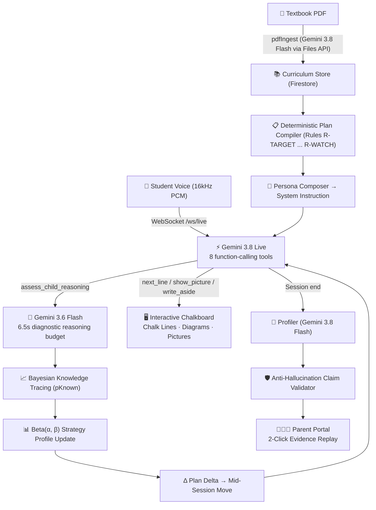

# Ananta — Adaptive AI Tutor

> **AI Builder Cup 2026 · Media, Content & Digital Experiences (Category: Education)**

**An AI tutor that diagnoses *how* a child reasons — not just *what* they answer — and adapts in real time.**

Ananta uses Gemini Live for voice-first tutoring, Bayesian Knowledge Tracing for evidence-based mastery, and a deterministic teaching plan compiler to deliver personalised, quality-gated lessons for any curriculum. Parents see every claim backed by the child's own words.

🔗 **[Live Demo on Cloud Run](https://ananta-ivczdbgbja-as.a.run.app/)** · 📑 **[Official Submission Deck (PDF)](docs/Submission_Template_AI_Builder_Cup_Filled.pdf)** · 🎬 **[Demo Video Script & Cues](docs/DEMO_VIDEO_SCRIPT.md)** · 🎙️ **[Presenter Voice Script](docs/PRESENTER_VIDEO_SCRIPT.md)** · 🎯 **[Use Case & Pitch Narrative](docs/USE_CASE_TALK.md)** · 💡 **[Adaptive Teaching Proof](docs/ADAPTIVE_TEACHING.md)** · 📊 **[Empirical Evaluation (EV-01)](docs/EVALUATION.md)** · 🏆 **[Rules Audit & Deliverables](docs/HACKATHON_AUDIT.md)**

---

## Why Ananta is Different

| Innovation | What it means |
|---|---|
| **Learns how each child learns** | Every checked answer updates, per type of idea, which ways of explaining work for this child using Beta distributions. The next lesson leads with what worked, avoids what didn't, and watches for the child's own mix-ups. Proof: `npm run test:adaptation` · [how it works](docs/ADAPTIVE_TEACHING.md) |
| **Catches the "Correct Answer Trap"** | Standard LLMs miss 43% of misconceptions hidden behind lucky guesses. Ananta's diagnostic loop catches 100% of hidden misconceptions (EV-01 benchmark). |
| **Bayesian Knowledge Tracing (BKT)** | Mastery is a probability, not a score. $pKnown \ge 0.80$ *and* $\ge 2$ level-3 demonstrations required — a right answer from guessing never triggers mastery. |
| **Deterministic plan compiler** | Teaching plans use zero GenAI — reproducible, auditable, mathematically explainable, never hallucinated. |
| **Evidence-centered mastery gates** | Bare MCQ answers are capped at "recognised" level. The child must explain reasoning to advance. |
| **Anti-hallucination claim validator** | Every profiler claim about a child must pass deterministic validation against real events before reaching a parent. |
| **Quality-gated content pipeline** | Every generated lesson, diagram, and photo passes an independent Gemini critic review. Failures are quarantined — never served. |
| **Tutor never gives up** | No "escalate to teacher" cop-out. Ananta always pivots to a worked example, concrete representation, or analogy. |
| **Two-click evidence replay** | Parents see the exact question asked, the child's exact answer, and the diagnostic reasoning — not just a grade. |
| **Growth-mindset language** | The tutor never uses deficit labels or fixed-trait stereotypes ("visual learner"). Enforced by deterministic lints. |
| **PDF → structured curriculum** | Upload any textbook PDF via Google Files API → Gemini extracts chapters, prerequisites, misconceptions, and pre-generates lessons automatically. |

---

## 📊 Empirical Evaluation (EV-01 Benchmark)

In our standardized EV-01 evaluation across 45 labeled cases over 5 real curriculum concepts:

| Metric | Answer-Checking Only (Standard Quiz Apps) | Plain Gemini Prompt ("Does child understand?") | Ananta Reasoning Assessor |
|---|:---:|:---:|:---:|
| **Catches Hidden Misconceptions behind Correct Answers** | 0% (0/10) | 90% (9/10) | **100% (10/10)** (95% CI 72–100%) |
| **False Alarms on Sound Student Reasoning** | 0% (0/10) | 0% (0/10) | **0% (0/10)** (95% CI 0–28%) |
| **Precision of Misconception Flags** | n/a | 82% (9/11) | **91% (10/11)** (95% CI 62–98%) |
| **Exact 5-Class Categorization** | n/a | 78% (35/45) | **93% (42/45)** (95% CI 82–98%) |

*Full methodology, confusion matrices, and safety bounds: [docs/EVALUATION.md](docs/EVALUATION.md).*

---

## Architecture



---

## Google AI & Cloud Services Used

| Service | Specific Usage in Ananta | Architecture Tier |
|---|---|---|
| **Gemini 3.8 Live** | Real-time bidirectional voice tutoring with 8 function-calling tools in guided mode (13 in standard), Puck voice, VAD | Frontier Voice API |
| **Gemini 3.8 Flash** | Multi-chapter textbook PDF ingestion, structured lesson generation, profiler, parent narrative report, critic reviews | Synthesis & Ingestion |
| **Gemini 3.6 Flash** | Real-time diagnostic assessment within a strict 6.5s budget during live voice conversation | Fast Diagnostic Loop |
| **Gemini 3.1 Flash Lite** | High-speed fallback model for diagnostic evaluation and lesson generation | Resilience & Fallback |
| **Gemini Vision** | Critic review engine inspecting generated educational imagery for pedagogical accuracy | Quality Gate |
| **Gemini Image Generation** | Real-world photo generation customized to student hobbies (football, cooking, space) | Grounding & Analogy |
| **Google Files API** | Multi-page PDF textbook and syllabus upload processing (60-page chunks, 40MB limit) | Document Intelligence |
| **Cloud Run** | Full-stack deployment (REST API + WebSocket proxy + Vite SPA), session affinity, 3600s timeout | Compute Infrastructure |
| **Firestore** | Server-side secure storage for learner models, BKT scores, event logs, and pregen cache | Secure Persistence |
| **Firebase Auth** | User authentication framework (bypassed in DEMO_MODE for zero-friction judge evaluation) | Identity |
| **Cloud Storage** | Public CDN bucket for pre-generated educational visuals and verified photos | Object Storage |

---

## Real-Time Voice Tools

The default **guided chalkboard tutor** gives Gemini Live 8 function-calling tools:

| Tool | Purpose |
|---|---|
| `advance_beat` | Start the next part of the prepared lesson |
| `next_line` | Write the next chalk line (holds back answers until the child replies) |
| `fill_slot` | Write the child's own answer into a blank on the board |
| `write_aside` | Answer a student interruption on the board as a side note, then resume |
| `show_picture` | Display a prepared diagram when the child asks to see something |
| `resume_lesson` | Return to exactly where the lesson paused after an interruption |
| `assess_child_reasoning` | Send the child's answer, reasoning, and representation used to the 6.5s diagnostic engine |
| `record_confusion_signal` | Log student confusion indicators to dynamically modulate pacing |

---

## Parent Portal & Two-Click Evidence Replay

Parents receive complete pedagogical transparency:
1. **Ananta's Plan for Next Lesson:** Placed prominently at the top, showing which strategy will be led with, what will be avoided, and which misconceptions will be probed.
2. **Misconception Ledger:** Tracks wrong beliefs across sessions (`suspected` → `confirmed` → `fixed`).
3. **Two-Click Evidence Replay:** Every statement in the progress report includes a *"See why"* link opening the child's exact spoken words, the question asked, and the AI's diagnostic reasoning.
4. **Actionable Home Tips:** Short 5-minute parent-child activities tailored to the child's active concepts.

---

## 👩‍🏫 Live Demo Comparison: Maya vs. Leo (Grade 4)

Ananta demonstrates how teaching plans diverge for two students studying the **exact same lesson** (*Money and decimal place value*):

| Dimension | Maya (Simulated) | Leo (Simulated) |
|---|---|---|
| **Learning History** | Spoken words failed; visual diagrams (place-value charts, number lines) succeeded. | Visual diagrams caused confusion; worked examples and written steps succeeded. Mix-up open: believes "$-5 > -1$". |
| **Strategy Scores** (`place-value-and-number-systems`) | Visual diagram: **0.91** (10 gains, 1 miss) · Spoken words: 0.33 | Worked example: **0.80** (4 gains, 1 miss) · Visual diagram: **0.17** (1 gain, 5 misses) |
| **Tutor System Prompt** | Lead with: **Visual Diagram** · Examples themed on drawing/football · Opener: *"Last time, visual diagram really helped you..."* | Lead with: **Worked Example** · **AVOID: Visual Diagram** · Watch for: *"$-5 > -1$"* · Examples themed on cooking/Lego |
| **Parent Plan Card** | *"Begin by drawing it out."* | *"Begin by working through an example together. Avoid a picture or diagram."* |

---

## Quickstart

```bash
# 1. Install dependencies
npm install

# 2. Set Gemini API Key
echo "GEMINI_API_KEY=your-gemini-api-key" > .env.local

# 3. Start local development
npm run dev                    # opens http://localhost:5173
```

### Seed Demo Learners

```bash
npm run seed:g4 -- --reset     # creates Maya and Leo with empirical learning histories
```

### Run Validation & Verification Suite

```bash
npm run test:adaptation         # automated proof: child's answers adapt the plan (10 checks)
npm run test:parent             # parent report evidence gates & zero jargon leak (25 checks)
npm run eval:diagnosis          # EV-01 45-case diagnostic benchmark report
npm run test:quality            # quality gates, lesson gen, quiz evidence, ladder
npm test                        # core assessor + plan delta tests
```

---

## For Evaluators / Judges

### Quick Start (No Account Required)

1. Open **[https://ananta-ivczdbgbja-as.a.run.app/](https://ananta-ivczdbgbja-as.a.run.app/)**
2. Click **"Maya (Simulated)"** or **"Leo (Simulated)"** — two Grade 4 learners with contrasting learning histories.
3. Select **Mathematics** → **Money and decimal place value** → **Start Lesson**.
4. Notice how Ananta opens differently for each child:
   - For **Maya**: Ananta draws out a place-value diagram.
   - For **Leo**: Ananta leads with a worked example and avoids diagrams.
5. Allow microphone access → speak naturally to test the live voice tutor.

> No credentials required. `DEMO_MODE=true` is enabled for instant evaluator access.

### Sample Questions to Ask the Tutor

- *"Why is minus five smaller than minus one?"* (As Leo: his plan explicitly watches for this mix-up).
- *"Can you show me a picture on the board?"* (Triggers `show_picture` tool).
- *"Wait, can you explain that again?"* (Tutor pauses, writes a side note via `write_aside`, then resumes).
- *"I don't understand this"* (Triggers confusion signal and mid-session strategy adaptation).
- *"Ten coins, because ten times ten cents is one hundred cents"* (Diagnostic assessor recognizes sound reasoning and updates BKT).

---

## Key Documentation

| Document | Description |
|---|---|
| [Submission_Template_AI_Builder_Cup_Filled.pdf](docs/Submission_Template_AI_Builder_Cup_Filled.pdf) | Official AI Builder Cup presentation deck (PDF, created from official template) |
| [Submission_Template_AI_Builder_Cup_Filled.pptx](docs/Submission_Template_AI_Builder_Cup_Filled.pptx) | Official AI Builder Cup presentation deck (editable PPTX template) |
| [DEMO_VIDEO_SCRIPT.md](docs/DEMO_VIDEO_SCRIPT.md) | Timed 3:35 demo video script with visual cue sheet and production guidelines |
| [PRESENTER_VIDEO_SCRIPT.md](docs/PRESENTER_VIDEO_SCRIPT.md) | Word-for-word voiceover teleprompter script with vocal direction |
| [USE_CASE_TALK.md](docs/USE_CASE_TALK.md) | Comprehensive use case narrative, Bloom's 2-Sigma problem, and executive pitch |
| [HACKATHON_AUDIT.md](docs/HACKATHON_AUDIT.md) | Full audit and compliance remapping against AI Builder Cup judging criteria |
| [ARCHITECTURE.md](docs/ARCHITECTURE.md) | Complete technical system architecture map |
| [EVALUATION.md](docs/EVALUATION.md) | EV-01 diagnosis accuracy evaluation methodology and limits |
| [PARENT_VIEW.md](docs/PARENT_VIEW.md) | Parent portal design and evidence-backed narratives |
| [TEACHING_PLAN.md](docs/TEACHING_PLAN.md) | Deterministic plan compiler design |

---

## License

Built for the [Google Cloud AI Builder Cup 2026](https://aibuildercup.com/).
