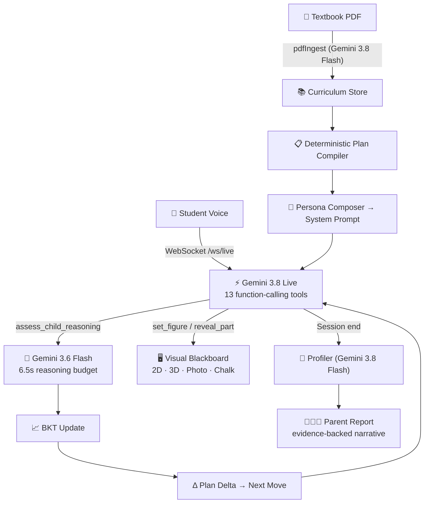

# Ananta — Adaptive AI Tutor

> **AI Builder Cup 2026 · Media, Content & Digital Experiences**

**An AI tutor that diagnoses *how* a child reasons — not just *what* they answer — and adapts in real time.**

Ananta uses Gemini Live for voice-first tutoring, Bayesian Knowledge Tracing for evidence-based mastery, and a deterministic teaching plan compiler to deliver personalised, quality-gated lessons for any curriculum. Parents see every claim backed by the child's own words.

🔗 **[Live Demo](https://ananta-ivczdbgbja-as.a.run.app/)** · 📄 [Architecture](docs/ARCHITECTURE.md) · 📊 [Evaluation](docs/EVALUATION.md) · 🎓 [Teaching Plan Design](docs/TEACHING_PLAN.md)

---

## Why Ananta is Different

| Innovation | What it means |
|---|---|
| **Bayesian Knowledge Tracing (BKT)** | Mastery is a probability, not a score. pKnown ≥ 0.80 *and* ≥ 2 level-3 demonstrations required — a right answer from guessing doesn't count. |
| **Deterministic plan compiler** | Teaching plans use zero GenAI — reproducible, auditable, never hallucinated. |
| **Evidence-centered mastery gates** | Bare MCQ answers are capped at "recognised" level. The child must explain reasoning to advance. |
| **Anti-hallucination claim validator** | Every profiler claim about a child must pass deterministic validation before it reaches a parent. |
| **Quality-gated content pipeline** | Every generated lesson, diagram, and photo passes an independent critic review. Failures are quarantined — never served. |
| **Tutor never gives up** | No "escalate to teacher" fallback. Ananta always pivots to a worked example or a different representation. |
| **Two-click evidence replay** | Parents see the exact question asked, the child's exact answer, and the diagnostic reasoning — not just a grade. |
| **Growth-mindset language** | The tutor never uses deficit labels or fixed-trait descriptions. Enforced by lint rules. |
| **PDF → structured curriculum** | Upload a textbook PDF → Gemini extracts chapters, concepts, prerequisites, misconceptions, and generates quality-reviewed lessons automatically. |

---

## Architecture



---

## Google AI Features Used

| Gemini Feature | How Ananta Uses It | Depth |
|---|---|---|
| **Gemini 3.8 Live** | Real-time bidirectional voice tutoring with 13 function-calling tools, Puck voice, VAD | Deep |
| **Gemini 3.8 Flash** | PDF ingestion, lesson generation, profiler, parent reports, critic reviews, photo generation | Deep |
| **Gemini 3.6 Flash** | Real-time reasoning assessment within a 6.5-second budget during live voice sessions | Deep |
| **Gemini 3.1 Flash Lite** | Fallback model for diagnosis and lesson generation (resilience) | Redundancy |
| **Gemini Vision** | Critic inspects AI-generated photos for pedagogical accuracy before serving | Novel |
| **Gemini Image Generation** | Real-world photo generation for visual analogies tied to student interests | Novel |
| **Google Files API** | PDF textbook upload (60-page chunks, 40 MB limit) for curriculum ingestion | Deep |
| **Structured Outputs** | JSON schema enforcement across all AI calls — no unstructured responses | Deep |
| **Thinking Budget** | Dynamic reasoning budget with auto-retry and model fallback | Novel |
| **Function Calling** | 13 real-time tools: board control, quizzes, reasoning assessment, confusion signals | Deep |

---

## Quickstart

```bash
npm install
echo "GEMINI_API_KEY=your-key" > .env.local
npm run dev                    # opens http://localhost:5173
```

### Load curriculum content

1. On the login screen, click **Content library (admin)**
2. Pick board + grade + subject, upload the textbook PDF
3. Gemini reads, structures, reviews, and publishes content automatically

### Seed demo learners

```bash
npm run seed:demo -- --reset   # creates Aisha, Marcus, Priya with rich evidence data
```

---

## Production (Cloud Run + Firestore + Cloud Storage)

One Google Cloud project. Cloud Run runs the Node server (REST API + Gemini Live WebSocket proxy + built SPA). Firestore stores curricula, lessons, and learner data. Cloud Storage holds pre-generated photos.

```bash
export PROJECT_ID=<your-project> REGION=<region> BUCKET=<your-bucket>
npm run deploy:live                                          # Cloud Run + Firestore rules/indexes
npm run migrate:cloud -- --dry-run && npm run verify:migration  # local → Firestore + Storage
```

Full setup guide: [docs/ANANTA_CLOUD_RUN_PLAN.md](docs/ANANTA_CLOUD_RUN_PLAN.md)

---

## 13 Real-Time Voice Tools

During a live tutoring session, Gemini Live calls these tools via function calling:

| Tool | Purpose |
|---|---|
| `set_topic` | Navigate to a curriculum concept |
| `set_figure` | Display a board picture (2D diagram, 3D model, or photo) |
| `reveal_part` | Step-by-step reveal of diagram elements |
| `update_diagram` | Modify the visual board in real time |
| `switch_board_view` | Toggle between diagram, 3D, photo, and chalkboard views |
| `update_chalkboard_notes` | Write structured notes on the chalk panel |
| `write_live_note` | Add a quick annotation |
| `highlight_concept` | Highlight a node in the concept map |
| `generate_photo_visual` | Generate a real-world photo analogy |
| `pose_quiz` | Present an assessment question |
| `assess_child_reasoning` | Trigger the 6.5s reasoning assessment pipeline |
| `show_student_thinking` | Make the student's reasoning visible on the board |
| `record_confusion_signal` | Log when the student signals confusion |

---

## Parent Portal

Parents see a plain-language report: what Ananta learned about their child, how it worked it out (with a *See why* link to the child's real answer behind every claim), the plan for the next lesson, and a home activity. An **Under the hood** toggle reveals the full engineering view with BKT curves, misconception ledgers, and strategy effectiveness data.

```bash
npm run seed:story              # creates Maya — a 5-lesson story arc showing misconception detection → correction
npm run test:parent             # offline tests: sentence/evidence gates, jargon-leak check, story logic
```

---

## Test Suite

```bash
npm test                        # core assessor + live + plan-delta tests
npm run test:quality            # quality gates, lesson gen, photo gen, quiz evidence, ladder, content spec
npm run test:gates              # quality + visuals + curriculum ingest
npm run test:parent             # parent report tests
npm run eval:diagnosis          # 45-case evaluation: catches right-answer-wrong-method errors
npm run verify                  # tsc + all gates + scorecard
```

---

## Key Documentation

| Document | Content |
|---|---|
| [ARCHITECTURE.md](docs/ARCHITECTURE.md) | System map — what IS, not what was planned |
| [CURRICULUM.md](docs/CURRICULUM.md) | Content pipeline: PDF → structured curriculum → pre-generated visuals |
| [LEARNER_MODEL.md](docs/LEARNER_MODEL.md) | BKT parameters, evidence ladder, mastery gates |
| [BOARD_VISUALS.md](docs/BOARD_VISUALS.md) | Visual generation: 2D diagrams, 3D models, photos, step-by-step reveals |
| [GUIDED_TUTOR.md](docs/GUIDED_TUTOR.md) | Guided mode lesson scripting |
| [PARENT_VIEW.md](docs/PARENT_VIEW.md) | Parent portal design and evidence-backed narratives |
| [TEACHING_PLAN.md](docs/TEACHING_PLAN.md) | Deterministic plan compiler design |
| [TUTOR_PERSONA.md](docs/TUTOR_PERSONA.md) | Persona composition and age-band adaptation |
| [EVALUATION.md](docs/EVALUATION.md) | Diagnosis accuracy evaluation methodology |
| [AGENT_GUIDE.md](docs/AGENT_GUIDE.md) | Developer guide — landmine patterns to avoid |

---

## License

Built for the [Google Cloud AI Builder Cup 2026](https://aibuildercup.com/).
