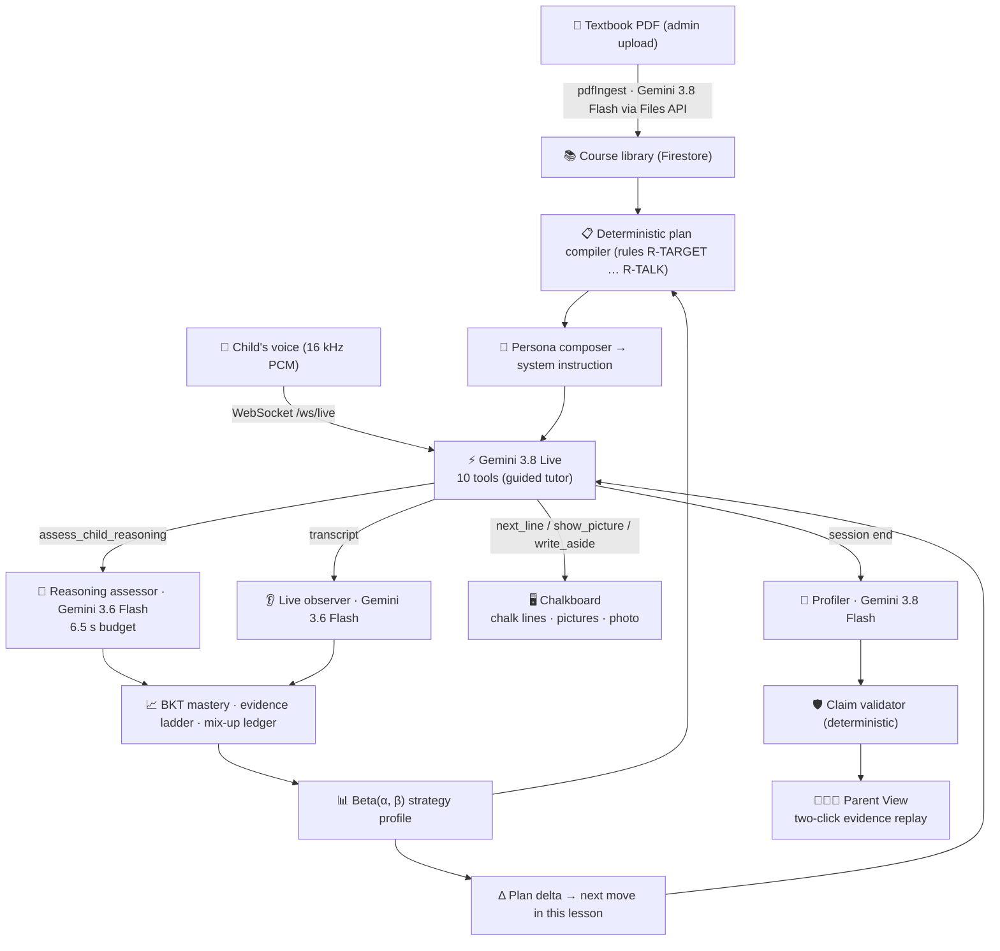

# Ananta — Adaptive AI Tutor

**A personal, voice-based tutor that adapts to how each child learns.**

> **AI Builder Cup 2026 · Theme: Media, Content & Digital Experiences · Category: Education**

**An AI tutor that diagnoses *how* a child reasons — not just *what* they answer — and adapts its teaching for that child.**

Ananta uses Gemini Live for voice-first tutoring, Bayesian Knowledge Tracing for evidence-based mastery, and a deterministic teaching-plan compiler to teach lessons built from uploaded textbooks. Parents see every claim backed by the child's own words.

🔗 **[Live demo on Cloud Run](https://ananta-ivczdbgbja-as.a.run.app/)** · 📊 **[EV-01 results](evals/diagnosis/results/latest/summary.md)** · 🧪 **[Evaluation set](evals/diagnosis/)**

> The submission deck, demo video and design documents are submitted through the Hack2skill portal and are **not stored in this repository** (see `.gitignore`). This README is the repository's documentation.

---

## Why Ananta is different

| Idea | What it means |
|---|---|
| **Learns what works for each child** | Every checked answer updates, per type of idea, a Beta(α, β) score for each way of explaining. The next lesson leads with what worked, avoids what repeatedly didn't, and watches for the child's own mix-ups. Proof: `npm run test:adaptation` |
| **Catches the "correct answer trap"** | Answer-checking alone cannot question a correct answer, so it catches none of these. On our 45-case EV-01 set (written by the team) Ananta's assessor flagged 10 of 10 hidden misconceptions (95% CI 72–100%) with no false alarms on sound reasoning. |
| **Bayesian Knowledge Tracing (BKT)** | Mastery is a probability, not a score: $pKnown \ge 0.80$ *and* level-3 evidence on $\ge 2$ different questions *and* no confirmed mix-up. A lucky right answer never counts as mastery. |
| **Deterministic plan compiler** | Teaching plans are compiled by named rules (R-TARGET … R-TALK) with no model call, so the same history always gives the same plan, and every choice carries a rule id and a reason. |
| **Evidence-centred mastery gates** | A multiple-choice answer with no reasoning is capped at "recognised". The child must explain to move up the ladder. |
| **Claim validator** | Every session-end claim the Profiler proposes about a child must cite real evidence events, and labels such as "visual learner" are rejected, before a parent sees it. |
| **Quality-gated content** | Generated lessons, board pictures and photos pass deterministic lints and a separate Gemini review call that never saw the drafting prompt. Anything that fails is withheld, never served. |
| **The tutor never gives up** | No "escalate to teacher". After misses Ananta switches to the next approach in the child's order, or teaches the idea directly. |
| **Two-click evidence replay** | Parents see the question asked, the child's exact answer and the diagnosis — not just a grade. |
| **No fixed-trait labels** | The tutor's language is linted for verdict words and labels; "what works" is scoped to a type of idea and fades over time. |
| **PDF → structured course** | An admin uploads a textbook (and optionally the syllabus) PDF; Gemini, via the Files API, extracts chapters, prerequisites and misconceptions, an AI review re-checks worked examples, and lessons are pre-generated. |

---

## 📊 Evaluation (EV-01)

EV-01 ran on 2026-10-17 (`gemini-3.6-flash`, the diagnosis model the live tutor uses) over 45 labelled cases across 5 curriculum concepts. Ten are the "right answer, broken method" trap.

| Metric | Answer-checking only | Plain Gemini prompt | Ananta reasoning assessor |
|---|:---:|:---:|:---:|
| **Catches hidden misconceptions behind correct answers** | 0% (0/10) | 100% (10/10) | **100% (10/10)** (95% CI 72–100%) |
| **False alarms on sound reasoning** | 0% (0/10) | 0% (0/10) | **0% (0/10)** (95% CI 0–28%) |
| **Precision of misconception flags** | n/a | 91% (10/11) | **100% (10/10)** (95% CI 72–100%) |
| **Exact 5-class classification** | n/a | n/a | **96% (43/45)** (95% CI 85–99%) |
| **Latency per diagnosis** | n/a | n/a | p50 3.2 s · p95 4.8 s · max 5.8 s |

Read it honestly: with 10 trap cases the intervals are wide, and a plain Gemini prompt also found all 10 on this run. The assessor raises fewer false flags and names a catalogued misconception for every hit. An earlier run (2026-10-15, fallback model `gemini-3.1-flash-lite`) gave 10/10, 0/10 false alarms and 93% (42/45) exact classification. Cases were written by the team and have not yet had a second reviewer. EV-02 (adapted vs non-adapted teaching) and EV-03 (persona adherence) are not built.

*Cases, runner and scoring: [`evals/diagnosis/`](evals/diagnosis/); recorded runs with per-case results: [`evals/diagnosis/results/`](evals/diagnosis/results/).*

---

## Architecture



Recording evidence, compiling the plan, rendering it into the tutor's instructions and choosing the next move are deterministic code in `src/adaptive/` and `src/plan/`; Gemini is used only where language must be judged or produced.

---

## Google AI & Cloud services used

| Service | How Ananta uses it |
|---|---|
| **Gemini 3.8 Live** | Real-time voice tutoring (voice "Puck", automatic voice-activity detection); 10 function-calling tools in the default guided tutor, 13 in the standard tutor |
| **Gemini 3.8 Flash** (`strong` / `review` roles) | Textbook and syllabus PDF ingestion, curriculum structuring and review, lesson and board-picture generation, session Profiler, parent report, and the separate quality-review call (including image review of generated photos) |
| **Gemini 3.6 Flash** (`fast` role) | Reasoning assessor during the live lesson (6.5 s budget), live observer, photo scene planning |
| **Gemini 3.1 Flash Lite** | Fallback model when a primary model fails or times out |
| **Gemini 3.1 Flash Image** | One lesson-specific photo per concept, planned from the concept's key facts, shown only after the review call verifies it, labelled "AI-generated illustration" |
| **Gemini Files API** | Uploading textbook / syllabus PDFs in chunks of up to 60 pages / 40 MB |
| **Cloud Run** | One service (`ananta`, `asia-southeast1`) serving the web app, REST API and the voice WebSocket; session affinity, 3600 s timeout |
| **Cloud Build + Artifact Registry** | Builds the container from the `Dockerfile` on `npm run deploy:live` |
| **Firestore** | Courses, pre-generated lessons, learner models, evidence events, plans and session summaries |
| **Cloud Storage** | Pre-generated lesson photos (public read on `pregen-images/` only) |
| **Secret Manager** | `GEMINI_API_KEY` and `ADMIN_TOKEN` for the Cloud Run service |
| **Firebase Auth** | Client SDK is included, but learner sign-in is **not wired yet**: the demo runs with `DEMO_MODE=true` (no token checks) |

Model IDs are resolved at startup by `src/ai/gateway.ts` and can be overridden with `MODEL_FAST`, `MODEL_STRONG`, `MODEL_REVIEW`, `MODEL_LIVE`, `MODEL_IMAGE`. Check which ones your key can use with `npm run verify:models`.

---

## Real-time voice tools

The default **guided chalkboard tutor** gives Gemini Live 10 tools:

| Tool | Purpose |
|---|---|
| `advance_beat` | Start the next part of the prepared lesson |
| `next_line` | Write the next chalk line (holds back answers until the child replies) |
| `fill_slot` | Write the child's own answer into a blank on the board |
| `write_aside` | Answer an interruption on the board as a side note, then resume |
| `show_picture` | Show a prepared picture when the child asks to see something |
| `skip_to_practice` | Jump to the practice questions when the child asks to be quizzed |
| `teach_skipped` | After a miss on a skipped part, go back and teach it |
| `resume_lesson` | Return to where the lesson paused |
| `assess_child_reasoning` | Send the child's answer, reasoning and the approach used to the reasoning assessor |
| `record_confusion_signal` | Log "I don't get it" signals, which change pacing |

Answers the tutor does not explicitly assess are still judged by the live observer and recorded as evidence (a mix-up is confirmed only after a second, later observation). Set `OBSERVER_EVIDENCE=off` to disable this.

---

## Parent View

1. **Ananta's plan for the next lesson** — at the top: which approach it will lead with, what it will avoid, which mix-ups it will check.
2. **How Ananta figured the child out** — each mix-up from "noticed" to "seen again" to "changed how it teaches" to "fixed".
3. **"See why" on every sentence** — opens the child's exact answer, the question and the diagnosis.
4. **Try this at home** — a short activity for the topic being learned.

An **Under the hood** switch shows the engineering view (mastery, ladder levels, rules). Code: `src/parent/`.

---

## 👩‍🏫 Same lesson, two learners: Maya vs Leo (Grade 4, simulated)

Two **simulated** learners (scripted answers run through the real pipeline, created by `npm run seed:g4`) open the same lesson, *Money and decimal place value*:

| | Maya (Simulated) | Leo (Simulated) |
|---|---|---|
| **History** | Plain spoken explanation did not land; pictures (place-value chart, number line) did. | Pictures left him unsure; worked examples and written steps did. Still believes "−5 is greater than −1". |
| **Strategy scores** (`place-value-and-number-systems`, Beta(1,1) start) | Picture **0.91** (9 gains, 0 misses) · plain explanation 0.33 (1 gain, 3 misses) | Worked example **0.80** (3 gains, 0 misses) · picture **0.17** (0 gains, 4 misses) |
| **Tutor is told** | Lead with a visual diagram · examples themed on football, drawing · *"Last time, visual diagram really helped you…"* | Lead with a worked example · **avoid visual diagram** · watch for "−5 is greater than −1" · examples themed on cooking, Lego |
| **Parent plan card** | *"Begin by drawing it out."* | *"Begin by working through an example together." "Avoid a picture or diagram…"* |

The board lines are identical for both; how they are taught is not.

---

## Run it locally

Requires **Node 22** and a Gemini API key from Google AI Studio (Gemini Live needs AI Studio credits).

```bash
npm install
cp .env.example .env          # then set GEMINI_API_KEY (the server reads .env)
npm run dev                   # http://localhost:3000
```

**Course data is not in the repository.** `data/` (courses, pre-generated lessons, learners) is gitignored. A fresh clone therefore starts with an empty library. Either:

- **use the Firestore project:** set `GOOGLE_CLOUD_PROJECT` and `FIREBASE_STORAGE_BUCKET` in `.env` and sign in with `gcloud auth application-default login` (needs access to the project), or
- **build your own library:** open *Content library (admin)* on the login screen and upload a textbook PDF (allowed from `localhost` without `ADMIN_TOKEN`; uses many Gemini calls).

The hand-written guided lessons in `src/guided/` are in the repository.

`npm run seed:g4 -- --reset` creates Maya and Leo, but it needs the Cambridge Grade 4 Mathematics course (`cambridge-lower-secondary--g4--mathematics`) in the library first.

### Tests

These run offline with no API key:

```bash
npm run lint                  # TypeScript check
npm run test:adaptation       # the child's answers change the next plan (10 checks)
npm run test:parent           # Parent View built only from real answers, no jargon (25 checks)
npm run test:cloud            # Firestore payloads + two-lesson adaptation on the built server
npm run test:gates            # content quality gates, board pictures, curriculum ingest
npm run test:eval             # EV-01 scoring code
```

`npm run eval:diagnosis` re-runs EV-01 against the real model (needs `GEMINI_API_KEY`). `npm test` includes `tests/live/run.mjs`, which has **7 known failing assertions** against an older snapshot of the voice path.

### Deploy

```bash
export PROJECT_ID=... REGION=asia-southeast1 BUCKET=...
npm run deploy:live           # Cloud Build → Cloud Run, then Firestore rules/indexes and a health check
```

Required variables and steps are documented at the top of `scripts/deploy-cloudrun.sh`. Secrets come from Secret Manager; never commit `.env` or service-account files.

---

## For evaluators

1. Open **[https://ananta-ivczdbgbja-as.a.run.app/](https://ananta-ivczdbgbja-as.a.run.app/)** — no account needed (`DEMO_MODE=true`).
2. Pick **Maya (Simulated)** or **Leo (Simulated)**.
3. Choose **Mathematics → Money and decimal place value** and start the lesson.
4. Compare the openings: Maya is shown a place-value picture first; Leo starts with a worked example and no picture.
5. Allow the microphone and talk to the tutor.

Things to try saying:

- *"Why is minus five smaller than minus one?"* — as Leo, his plan watches for this mix-up.
- *"Can you show me a picture?"* — `show_picture`.
- *"Wait, can you explain that again?"* — the tutor answers on the board with `write_aside`, then resumes.
- *"I don't understand this."* — a confusion signal; pacing and approach change.
- *"Ten coins, because ten times ten cents is one hundred cents."* — sound reasoning is recognised and recorded.

**Known limits:** spaced review is not scheduled for live learners yet (mastery reaches "provisional", not "durable"); `DEMO_MODE` lets anyone with the link see every learner, so the deployment must hold demo data only; Maya and Leo are simulated, not real children.

---

## Repository layout

| Path | What it is |
|---|---|
| `server.ts`, `server/` | Express API, Gemini Live WebSocket relay, auth/admin middleware, text-tutor route |
| `src/adaptive/` | Learner model: reasoning assessor, live observer, BKT, ladder, strategy profile, Profiler, claim validator, repositories (file / Firestore) |
| `src/plan/` | Deterministic plan compiler, in-lesson plan delta, prompt rendering |
| `src/persona/` | The single tutor persona, composed into the system instruction |
| `src/guided/` | Guided chalkboard tutor and its hand-written lessons |
| `src/curriculum/` | PDF ingestion, course structure, lesson / photo generation, pre-generation store |
| `src/visual/`, `src/quality/` | Board-picture vocabulary and renderer; quality lints and the review call |
| `src/parent/` | Parent View report |
| `src/ai/gateway.ts` | Single model gateway: model resolution, timeouts, fallback, logging |
| `evals/diagnosis/` | EV-01 cases, runner, metrics and recorded results |
| `tests/` | Offline test suites |
| `scripts/` | Deploy, migration, seeding, pre-generation, verification |
| `functions/` | Legacy Cloud Functions API — **not deployed or used** |

**Not in the repository (gitignored):** `data/` (courses, lessons, learners), `.env*` and service-account keys, `docs/` (design documents, diagrams, submission decks, internal notes), `PROJECT_STATE.md` / `DECISIONS.md` (internal logs), videos, `logs/`, `backups/`, `parked/`, build output.

---

## License

No open-source licence has been granted; all rights reserved. Built for the [Google Cloud AI Builder Cup 2026](https://aibuildercup.com/).
